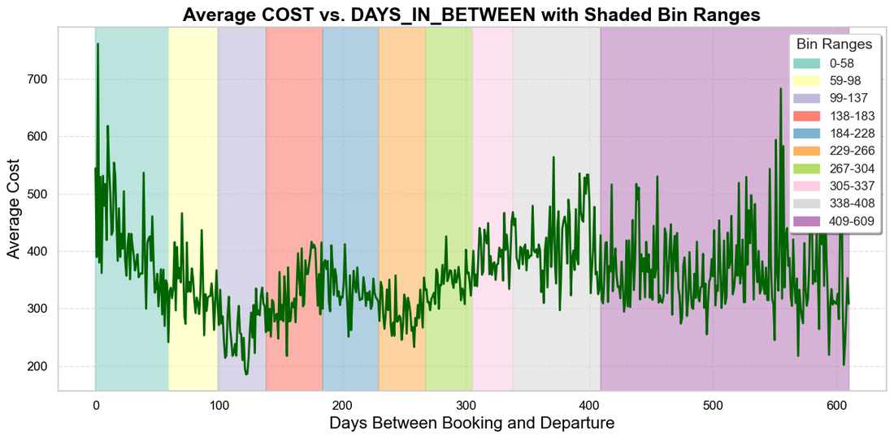
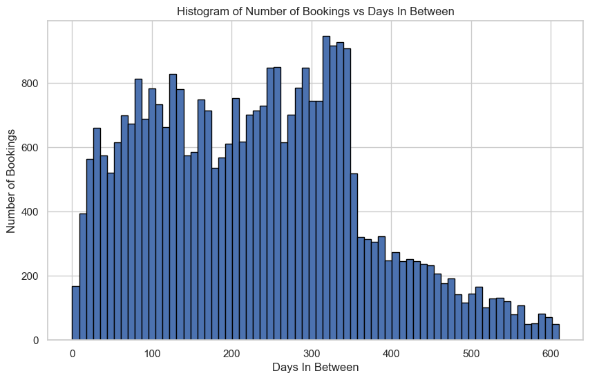
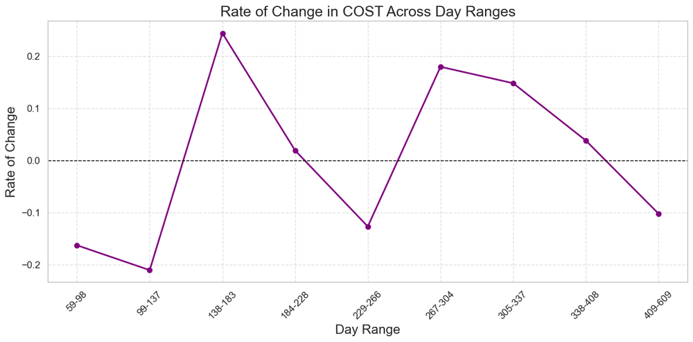
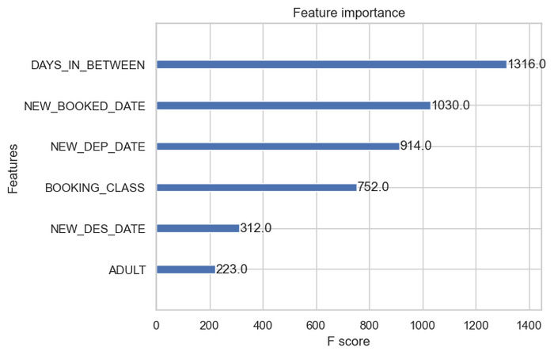
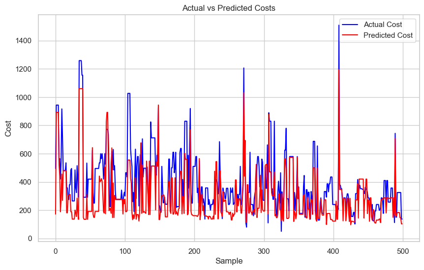

<div align="center">

# ✈️ Airfare vs Booking Lead Time: When Should You Book?

**R&D analysis of how flight cost changes with the number of days between booking and departure, plus an XGBoost model that predicts the fare for each booking window.**




</div>

---

## 📌 The question

For a given route, **how does the fare move as the departure date gets closer?** If we can model that, a booking system can tell a customer, or a pricing team, which booking window is likely to be cheapest.

## 🔍 Approach

1. **Data preparation:** historical flight bookings with route, airline, booking class, passenger counts, cost and booking / departure / return dates
   - Filtered to **Economy, ITX fares**
   - Engineered `DAYS_IN_BETWEEN` (booking → departure lead time), total passengers, per-head cost and transit counts
2. **Route selection:** found the most frequent *route + airline + booking class* combinations. The analysis focuses on the busiest route, **LHR → CMB → MLE → CMB → LHR** on SriLankan Airlines (33.5k bookings).
3. **Lead-time binning:** split lead time into **10 equal-frequency bins** (0–58 days up to 409–609 days, about 3.3k bookings each), then measured average cost and the **rate of change of cost between bins**
4. **Seasonality features:** booking, departure and return dates converted to day-of-year so the model can learn seasonal pricing
5. **Modelling:** an **XGBoost regressor** predicts the adult fare from lead time, booking class, passenger count and the seasonal date features
6. **Booking-window simulation:** for a given trip, shift the booking date into each lead-time bin and predict the fare in every window

<p align="center">
  
  
</p>

## 📈 Findings

- On this route, fares **fall from the 0–58 day window to a low around 99–137 days out**, then climb again for very early bookings (305–408 days).
- **Lead time is the single most important feature**, followed by the booking and departure dates (seasonality) and the booking class.

| Evaluation | MSE | RMSE |
|---|:-:|:-:|
| Time-based split (train < 2022, test 2022–2024) | 22,797 | **151.0** |
| Held-out last 500 bookings | 27,606 | 166.1 |

<p align="center">
  
  
</p>

## 📂 Files

| File | Description |
|---|---|
| `notebooks/airfare_lead_time_analysis.ipynb` | ⭐ Main analysis: cleaning, route selection, lead-time binning, cost-change analysis, XGBoost model and booking-window simulation |
| `notebooks/experiments/flight_bookings_eda_and_forecasting.ipynb` | Earlier exploration joining booking and sector data, with LSTM and other forecasting models |
| `notebooks/experiments/route_fare_regression.ipynb` | Route-level fare regression with high-season event features (F1, festivals and so on) |

## 🚀 Running

```bash
pip install pandas numpy matplotlib seaborn plotly statsmodels scikit-learn xgboost dask
jupyter notebook notebooks/airfare_lead_time_analysis.ipynb
```

> ⚠️ The booking dataset (`routes_with_total_distances.csv`) is proprietary and not included in this repository.

---

<div align="center"><sub>Built by <a href="https://github.com/minudakaliyanage">Minudaka Liyanage</a></sub></div>
